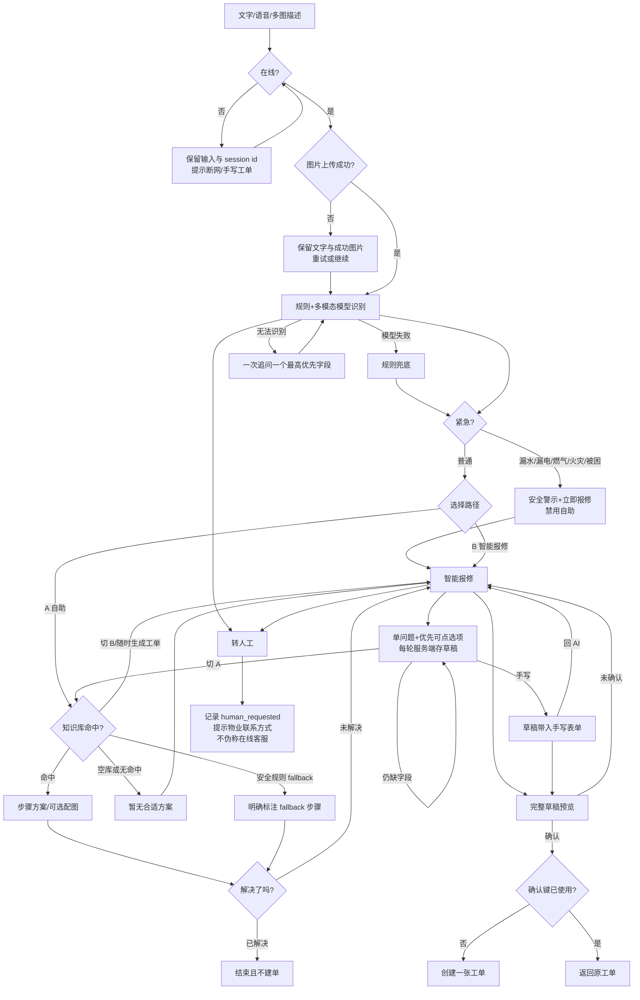

# 学生端 AI 智能受理设计

一句话定位：把文字、语音转写和多图合并为一次可恢复、可解释、确认后才建单的宿舍故障受理。

## 完整流程



## 优先级与 MVP

- **P0 / MVP（本次实现）**：统一文字/语音/多图；紧急强制报修；规则兜底；明确 `kb_status=empty` 与安全 fallback；A/B 路径；单问题选项；服务端草稿、刷新恢复、手写带入；确认前不建单；确认幂等；跨账号与图片归属校验；断网/上传/登录过期提示；转人工占位状态；中英双语；隐私最小化事件。
- **P1**：接入审核后的真实知识库/向量检索；物业值班系统；管理员漏斗聚合；SSE 分块传输（当前 `response_mode=complete`，状态机已预留）。
- **P2**：方案图片内容管理、跨轮视觉定位、人工接管对话、A/B 实验与个性化排序。均不影响 MVP 建单闭环。

## 页面线框与状态

### AI 对话页

```text
┌ AI 智能受理 ─ 描述>分流>草稿>确认 ┐
│ [紧急] 红色安全警示 + [立即报修]    │
│ 对话记录 / 识别中骨架 / 网络错误重试 │
│ 类别  紧急度  置信度  缺失字段       │
│ [选项1] [选项2] [A自助] [B报修]      │
│ [文字…………] [语音] [拍照/相册] [发送]│
│ [转人工] [改为手写]                   │
└ 空:输入示例 加载:发送禁用 错:可重试   ┘
成功:分流可选；紧急:自助隐藏。
```

### 自助方案页

```text
┌ 自助维修（可随时生成工单）──────────┐
│ 空/无命中: 暂无合适方案 [智能报修]   │
│ fallback: 非知识库命中·安全规则建议   │
│ 1 [可选图] 步骤                       │
│ 2 [可选图] 步骤                       │
│ 问题解决了吗? [已解决] [未解决报修]   │
└ 加载/错误不阻断 [生成工单]            ┘
成功:无工单结束；紧急:本页不可进入。
```

### 草稿 / 手写页

```text
┌ 已保存草稿 ─ 手写模式 ──────────────┐
│ 类别[选] 现象[选] 地点[账号/公共区域] │
│ 紧急度[选] 日期[选] 时段[多选]        │
│ 描述[可编辑] 图片[保留]               │
│ 保存中… / 已保存 / 保存失败稍后重试    │
│ [回到AI] [预览工单]                   │
└ 空:提示必填 错:字段旁提示 成功:已同步  ┘
紧急:顶部持续安全警示。
```

### 确认页

```text
┌ 提交前确认 ─────────────────────────┐
│ 类别/现象/地点/紧急度/日期时段/图片数 │
│ 提醒:未承诺维修时间、不判断收费或责任  │
│ [返回修改] [确认创建工单]              │
└ 加载:按钮锁定 错:保留草稿可重试        ┘
成功:显示原/新工单号；重复点击不重复建单。
```

## 短话术（每轮不超过 3 句）

- 普通：“我识别为网络故障，紧急度普通，置信度中。你可以先看安全建议，或直接生成报修草稿。”
- 紧急：“这可能涉及漏电，请远离故障点且不要触碰或拆修。请立即联系校园保卫/物业，并点击‘立即报修’。”
- 追问：“还差一个关键信息：故障是完全不能用、时好时坏，还是有漏水/异响？请选择最接近的一项。”
- 无方案：“知识库当前为空，暂无合适方案。你可以直接生成工单，刚才的识别和图片都会保留。”
- 转人工：“已记录转人工请求。当前未接入在线客服，请联系宿管或物业值班电话；草稿已保留。”

English follows the same two-sentence structure: identify/ask first, action and safety second; never promise arrival time or decide charges/liability.

## 组件、状态机与恢复

- `UnifiedComposer`：文本、Web Speech transcript、多图上传；单消息提交。
- `RecognitionCard`：`detected/confidence/missing/emergency`。
- `RouteChooser`：`self_help | smart_repair`；紧急只开放后者。
- `QuestionTurn`：仅一个 `next_question`，`question_options` 由服务端白名单验证。
- `SolutionSteps`：`solution.steps[{text,image_url?}]`，显示 `kb_status/source`。
- `DraftEditor` / `TicketPreview` / `HumanHandoffNotice`。

状态机：

```text
describe -> recognizing -> clarify -> route
route -> self_help -> resolved | smart_repair
route -> smart_repair -> clarify | draft
任意非终态 <-> manual
任意非终态 -> human_handoff（草稿保留）
draft -> preview -> confirming -> ticket_created
confirming -> preview(error) | ticket_created(idempotent)
任意请求 -> offline/upload_error/auth_expired；恢复后回原状态
```

服务端 `agent_sessions` 是唯一事实源，保存 `history/draft/state/active_route/image_ids`；浏览器 `localStorage` 只存不含敏感信息的 session id。刷新后鉴权读取 session，校验归属并恢复；不存在、已完成、跨账号或登录过期时清除本地 id。编辑表单 350ms 防抖同步，冲突以最近一次服务端成功保存为准。

## 接口与 JSON

- `POST /api/agent/session`：创建；`GET /api/agent/session?id=`：归属校验后恢复。
- `POST /api/uploads`：最多 5 张 JPG/PNG、每张 5MB；服务端验签名、用途和所有者。
- `POST /api/agent/message`：消息、选项或动作；选项和值均由服务端验证。
- `POST /api/agent/confirm`：仅 `ready` 草稿；重复确认返回原 ticket 且 `idempotent=true`。
- `POST /api/agent/event`：受鉴权、白名单、无全文/图片/电话事件。

消息请求：

```json
{"id":"A…","text":"插座冒火花","image_ids":["F…"],"transcript":false}
```

识别/方案响应（旧字段 `stage/ready/missing/self_help` 同时保留）：

```json
{
  "contract_version":2,"state":"follow_up","response_mode":"complete",
  "detected":{"repair_type":"power","priority":"urgent"},
  "confidence":"high","emergency":true,
  "route_options":[{"id":"smart_repair","enabled":true,"recommended":true}],
  "kb_status":"empty","solution":null,
  "next_question":null,"question_options":[],
  "draft":{"repair_type":"power","priority":"urgent","description":"…","image_ids":["F…"]}
}
```

安全 fallback 方案：

```json
{"kb_status":"empty","solution":{"source":"fallback","safety_reviewed":true,"steps":[{"text":"重启宿舍路由器一次","image_url":null}]}}
```

草稿保存与确认：

```json
{"id":"A…","action":"save_draft","draft":{"repair_type":"network","priority":"normal","expected_date":"2026-10-22","slots":[[4,7]]}}
```

```json
{"id":"A…","date":"2026-10-22","slots":[[4,7]],"repair_type":"network","priority":"normal","description":"…"}
```

工单成功/幂等：

```json
{"ok":true,"idempotent":true,"ticket":{"id":"T1234ABCD"}}
```

## 边界与安全

- 模型超时、非 JSON、字段非法：最多重试后规则兜底；不把 API key、故障全文或图片写日志。
- 紧急词优先于模型结论，自助接口也返回 `emergency_requires_report`。
- 图片必须属于当前账号、未绑定其他工单且用途合法；session、草稿、确认均校验账号。
- 上传部分失败保留文本与成功项；断网不清输入；401 走统一登录过期处理。
- 前端发送与确认期间禁用按钮；服务端 ticket id 是最终幂等依据。
- 空库绝不伪称命中；规则建议标 `fallback`。不承诺具体上门时间，不判断收费和责任。
- 当前后端返回完整 JSON，`response_mode=complete`；前端状态允许未来 `streaming/chunk/final`。

## 埋点与指标

事件仅记录 session id、事件名、state、route、emergency、lang、时间；不记录描述、图片、手机号或房间全文。P0 事件：`intake_started/route_selected/question_answered/draft_saved/draft_restored/confirm_started/confirm_succeeded/network_error/upload_failed/human_requested/resolved_without_ticket`。

- 分流完成率 = 进入 `route` 的 session / `intake_started`。
- 自助解决率 = `resolved_without_ticket` / 选择 self_help。
- 报修转化率 = `confirm_succeeded` / 选择 smart_repair。
- 草稿恢复成功率 = `draft_restored` / 有效恢复尝试。
- 平均追问轮数 = `question_answered` / 已分流 session。
- 紧急立即报修率 = 紧急 `confirm_started` / emergency session。
- 确认重复率 = 幂等确认次数 / 全部确认请求；上传失败率和网络错误率按 session 去重。
- P1 管理端只展示按日聚合且小样本抑制，不下钻个人内容。
